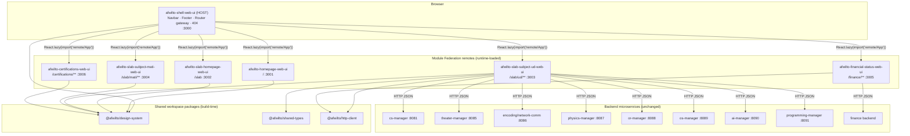
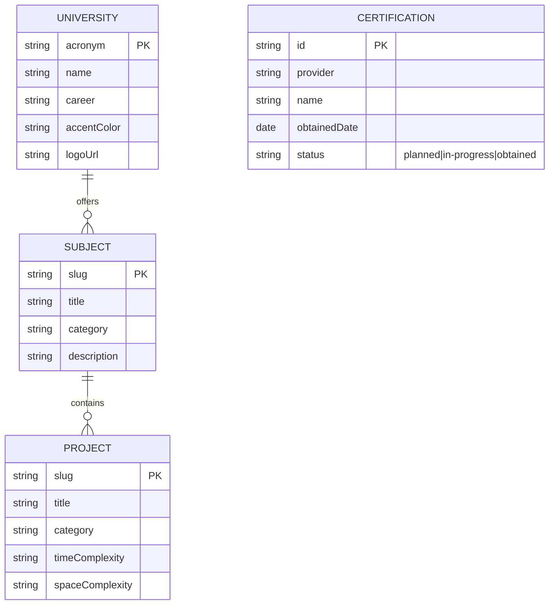
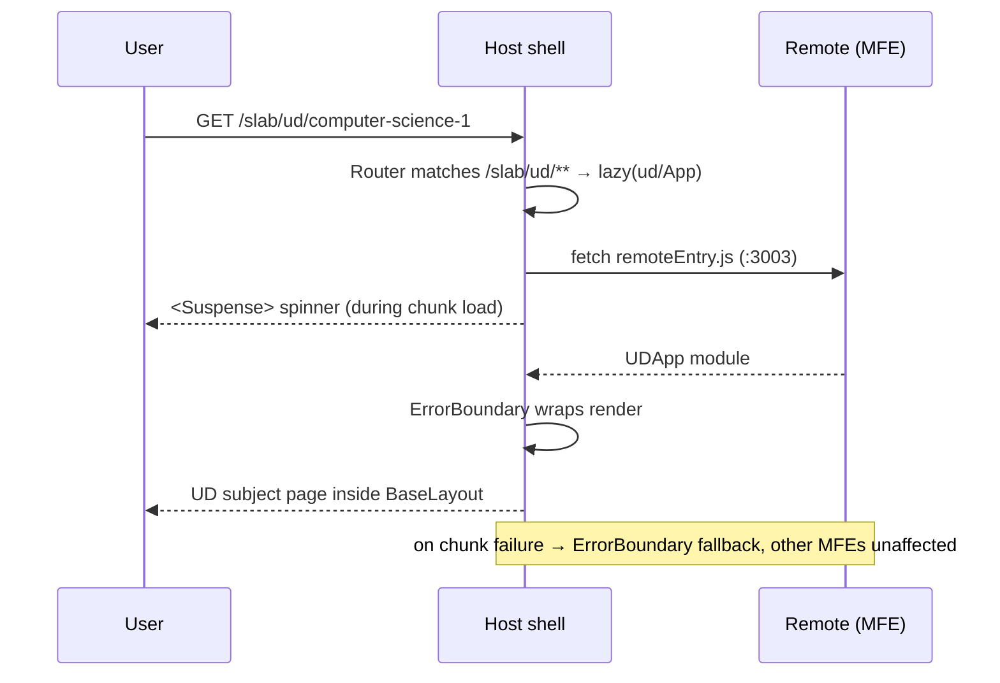

# Spec 00 — System Architecture: AFWILTO Frontend Microfrontend Platform

> Status: **Approved** (derived from `MICROFRONTEND_MIGRATION_PLAN.md`, 2026-06-29)
> Owner: afwilto · Last updated: 2026-07-02
> This is the umbrella spec. Each app/package has its own spec in `docs/specs/`.

---

## 1. System Architecture

### 1.1 Goal

Split the `afwilto-slab-homepage-web-ui` monolith into independently developed,
tested, and deployed microfrontends (MFEs) composed at runtime by a host shell
using **Module Federation**, mirroring the feature split the backend already has.

### 1.2 Architecture Diagram



### 1.3 Main Components

| Component | Kind | Responsibility |
|---|---|---|
| `afwilto-shell-web-ui` | MF **host** | Global chrome (Navbar/Footer/BaseLayout), URL gateway, 404, design-system showcase, error boundary + suspense per remote |
| `afwilto-homepage-web-ui` | MF remote | Root personal-brand landing (`/`) |
| `afwilto-slab-homepage-web-ui` | MF remote | Software-lab landing (`/slab`) — UD + MATI cards |
| `afwilto-slab-subject-ud-web-ui` | MF remote | All Universidad Distrital subjects (`/slab/ud/**`), hexagonal ports/adapters to 9 backend services |
| `afwilto-slab-subject-mati-web-ui` | MF remote | MATI/Uniandes subjects (`/slab/mati/**`) |
| `afwilto-financial-status-web-ui` | MF remote | Personal finance tracker (`/finance/**`), wrapped as-is |
| `afwilto-certifications-web-ui` | MF remote | Certifications catalog + roadmap (`/certifications/**`), static data behind a port |
| `@afwilto/design-system` | package | Atomic-design UI library + dark-theme tokens (Tailwind v4 `@theme`) |
| `@afwilto/shared-types` | package | `Result<T,E>` and shared domain primitives |
| `@afwilto/http-client` | package | `IHttpClient` port + `FetchHttpClient` adapter |

### 1.4 Relations Between Modules

- **Host → remotes:** runtime only, via Module Federation `remotes` config and
  `React.lazy`. The host never imports remote source code.
- **Remotes → packages:** build-time pnpm `workspace:*` dependencies. The
  design system is intentionally **not** federation-shared — it bundles into
  each MFE (CSS isolation, independent deploys).
- **Federation-shared singletons:** `react`, `react-dom`, `react-router-dom`.
- **Remotes ↔ remotes:** never directly. Cross-section navigation is URL-based.
- **Remotes → backend:** HTTP `fetch` through `IHttpClient`, always behind a
  domain port consumed via `useServices()` (hexagonal rule carried forward).

---

## 2. Module Specifications

Per-module detail lives in the dedicated specs:

| Module | Spec |
|---|---|
| Shared packages (Phase 0) | `01-shared-packages.md` |
| Host shell (Phase 1) | `02-shell-host.md` |
| Slab homepage MFE (Phase 2) | `03-slab-homepage-mfe.md` |
| Root homepage MFE (Phase 3) | `04-afwilto-homepage-mfe.md` |
| UD subjects MFE (Phase 4) | `05-ud-subjects-mfe.md` |
| MATI MFE (Phase 5) | `06-mati-mfe.md` |
| Finance MFE (Phase 6) | `07-finance-mfe.md` |
| Certifications MFE (Phase 7) | `08-certifications-mfe.md` |

---

## 3. Interfaces

### 3.1 Module Federation contract (host ↔ every remote)

- Every remote exposes exactly one entry: `exposes: { './App': './src/App.tsx' }`.
- The exposed `App` is a self-contained React component that renders the MFE's
  routes. It must render inside the host's `<BrowserRouter>` context (remotes
  use `<Routes>`, never a second router when federated).
- `shared: ['react', 'react-dom', 'react-router-dom']` with singleton semantics.
- Remote entry URL convention (dev): `http://localhost:{port}/remoteEntry.js`,
  overridable per environment via `VITE_REMOTE_*_URL` env vars in the host.

### 3.2 URL gateway (host router)

```
/                 → afwilto_home/App
/slab             → slab_home/App
/slab/ud/**       → ud/App
/slab/mati/**     → mati/App
/finance/**       → finance/App
/certifications/**→ certifications/App
/design-system    → host-local DesignSystemPage
*                 → host-local NotFoundPage
```

### 3.3 Backend data format

All academic backend services respond with the Go envelope
`{ "data": <T> }` over JSON. Adapters unwrap `.data` and translate HTTP errors
to human-readable `Error` messages. HTTP status codes never leak past adapters.

---

## 4. Data Model

The platform is a frontend; persistent data lives in the backend services.
Frontend-owned data models are static TypeScript catalogs:



Constraints: slugs are unique per university and are URL segments (kebab-case);
category values are closed unions per data file.

---

## 5. Processing Flows

### 5.1 Remote loading (sequence)



### 5.2 Backend call (activity)

Page → `useServices().xService.operation()` → adapter builds request via
`IHttpClient` → backend → adapter unwraps `{data}` / translates error → page
renders result or human-readable error.

---

## 6. Business Logic

- Domain logic (algorithms, schedulers, solvers) lives **in the backend**;
  MFEs visualize results. Frontend business rules are limited to: input
  validation before calls, catalog filtering, and presentation state machines
  (wizard steps, game turn flow).
- Cross-cutting rules: hexagonal boundary, Atomic Design layering, dark theme
  on `#181D35`, YAGNI (no event bus, no preemptive abstractions).

---

## 7. Non-Functional Requirements

| Attribute | Requirement |
|---|---|
| Performance | Root homepage MFE loads with no backend calls; each MFE is an independent chunk loaded on demand; React/ReactDOM/Router are singletons (one copy in browser) |
| Scalability | New product = new remote + one host route entry; UD internal features are lazy chunks with a ~2 MB gzip split trigger |
| Availability | A failing remote degrades only its URL slice — host ErrorBoundary isolates it |
| Security | No secrets in frontend code; backend URLs via `VITE_*` env vars; CORS handled by backends |
| Maintainability | One MFE per domain, specs in `docs/specs/`, tests per package/app, TypeScript strict + `erasableSyntaxOnly` |
| Accessibility | Focus-visible outlines, semantic HTML, contrast per dark-theme token table |

---

## 8. Technologies

| Concern | Choice |
|---|---|
| Language | TypeScript (strict, `erasableSyntaxOnly: true`) |
| UI | React 19 |
| Build | Vite 8 |
| Composition | `@module-federation/vite` |
| Styling | Tailwind CSS v4 (`@tailwindcss/vite`, `@theme` tokens) |
| Routing | React Router v7 (`react-router-dom`) |
| HTTP | native `fetch` via `@afwilto/http-client` |
| Monorepo | pnpm workspaces |
| Tests | Vitest (+ @testing-library/react + jsdom for components) |
| Database | none in frontend (backend services own persistence) |

---

## 9. Error Handling

| Failure | Strategy |
|---|---|
| Remote entry unreachable | Host `ErrorBoundary` per remote slot renders a fallback card; rest of shell keeps working |
| Remote chunk slow | `<Suspense>` spinner (`bg-surface-base`) |
| Backend HTTP ≥ 400 | Adapter throws `Error('<human message>')`; page shows `Alert variant="error"`; status codes never leak to pages |
| Backend unreachable / network | Same adapter translation path; retry is user-initiated (no automatic retry loops) |
| Unknown route | Host `NotFoundPage` (404) |
| Render error inside an MFE | Nearest ErrorBoundary fallback |

Error code taxonomy in frontend: none (deliberate). Human-readable messages
only; machine error codes stay in backend contracts.

---

## 10. Assumptions & Constraints

- **Technical limits:** single developer; no CI per MFE yet; Module Federation
  requires all remotes built with compatible shared-dependency versions.
- **External dependencies:** the 9 backend managers must run locally on their
  documented ports for interactive features; finance backend is separate.
- **Infrastructure:** dev = 7 Vite dev servers (ports 3000–3006); prod = static
  hosting per MFE with env-var remote URLs. No server-side rendering.
- **Accepted breaking changes:** `/universidad-distrital/**` → `/slab/ud/**`,
  `/uniandes/**` → `/slab/mati/**`.
- **Non-goals:** no event bus, no global auth (future), no nx build caching,
  no npm publishing of packages, no refactor of finance internals during
  integration.
