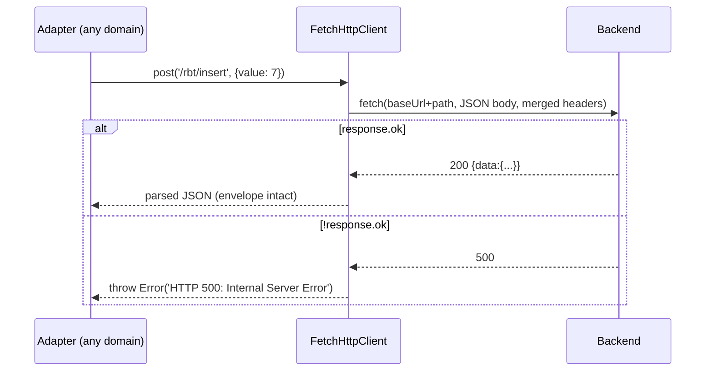

# Spec 01 — Phase 0: Monorepo & Shared Packages

> Status: **Approved** · Phase 0 of the MFE migration
> Depends on: `00-system-architecture.md`

---

## 1. Architecture

### 1.1 Problem & Goal

Three concerns are trapped inside the monolith and must be consumed by every
future MFE: the design system, the `Result` primitive, and the HTTP client.
Phase 0 extracts them into pnpm workspace packages with **zero functional
change** to the running app.

### 1.2 Diagram

```mermaid
flowchart LR
    subgraph frontend/ (pnpm workspace root)
        MONO["afwilto-slab-homepage-web-ui<br/>(monolith, unchanged behavior)"]
        subgraph packages/
            DS["@afwilto/design-system"]
            ST["@afwilto/shared-types"]
            HC["@afwilto/http-client"]
        end
    end
    MONO -->|workspace:*| DS & ST & HC
    DS -.->|peer| REACT["react · react-router-dom"]
    HC --> ST
```

### 1.3 Component relations

- Packages are consumed **as TypeScript source** (`exports` → `./src/index.ts`);
  every consumer is a Vite app with `moduleResolution: bundler`, so no package
  build step is needed. Each package still typechecks and tests independently.
- `@afwilto/design-system` additionally exports `./styles.css` (Tailwind v4
  `@theme` tokens + base layer). Consumers `@import` it after
  `@import "tailwindcss"` and add an `@source` directive so Tailwind scans the
  package's component classes.
- `@afwilto/http-client` has no dependency on the design system;
  `@afwilto/shared-types` has no dependencies at all.

## 2. Module Specifications

| Module | Responsibility | Inputs | Outputs | Dependencies |
|---|---|---|---|---|
| `@afwilto/shared-types` | Shared domain primitives | — | `Result<T,E>`, `ok()`, `err()` | none |
| `@afwilto/http-client` | HTTP port + fetch adapter | `baseUrl`, path, body, `RequestOptions` | parsed JSON `T` or thrown `Error('HTTP <status>: <text>')` | none (uses global `fetch`) |
| `@afwilto/design-system` | Atomic-design UI kit + tokens | props per component | React elements; CSS custom properties | peers: `react`, `react-dom`, `react-router-dom`; dep: `clsx` |
| monolith (re-pointed) | unchanged app | — | same UI as before | the three packages |

Design-system contents (moved verbatim): tokens/, atoms/ (Badge, Button,
Input, Spinner, Text), molecules/ (Alert, Card, ErrorBoundary, FormField),
organisms/ (Footer, Navbar), templates/ (AuthLayout, BaseLayout).

## 3. Interfaces

### 3.1 Package public APIs (contracts)

```ts
// @afwilto/shared-types
export type Result<T, E = Error> =
  | { success: true; data: T }
  | { success: false; error: E }
export const ok: <T>(data: T) => Result<T>
export const err: <E = Error>(error: E) => Result<never, E>

// @afwilto/http-client
export interface RequestOptions { headers?: Record<string,string>; signal?: AbortSignal }
export interface IHttpClient {
  get<T>(url: string, options?: RequestOptions): Promise<T>
  post<T>(url: string, body: unknown, options?: RequestOptions): Promise<T>
  put<T>(url: string, body: unknown, options?: RequestOptions): Promise<T>
  delete<T>(url: string, options?: RequestOptions): Promise<T>
}
export class FetchHttpClient implements IHttpClient { constructor(baseUrl: string) }

// @afwilto/design-system — barrel re-export of tokens/atoms/molecules/organisms/templates
// plus subpath export "./styles.css"
```

### 3.2 Data format

`FetchHttpClient` sends/receives JSON (`Content-Type: application/json`).
Backend envelope unwrapping stays in per-domain adapters, NOT in this package.

### 3.3 Monolith compatibility shims

To keep the diff minimal and behavior identical:

- `src/application/ports/index.ts` re-exports `IHttpClient`, `RequestOptions`
  from `@afwilto/http-client` (type-only re-export).
- `src/infrastructure/adapters/http/index.ts` re-exports `FetchHttpClient`.
- `src/domain/shared/index.ts` re-exports from `@afwilto/shared-types`.
- All `@/design-system` imports are rewritten to `@afwilto/design-system`;
  the local `src/design-system/` directory is deleted.
- `src/index.css` keeps `@import "tailwindcss"` and imports the package's
  `styles.css` + `@source`s the package directory.

## 4. Data Model

No persistent data. The only typed data structure introduced is `Result<T,E>`
(discriminated union on `success`). Constraint: `ok`/`err` are the only
constructors used across the codebase.

## 5. Processing Flows



## 6. Business Logic

- `Result` never throws — it encodes success/failure in the type.
- `FetchHttpClient`: merges custom headers over the JSON default; serializes
  body only when provided (GET/DELETE send none); passes `AbortSignal` through.
- Design-system rules carried forward verbatim: Atomic layering, dark theme,
  Tailwind v4 declaration-order override rule.

## 7. Non-Functional Requirements

- **Performance:** no extra runtime cost — packages compile into each app
  exactly as the previous local source did.
- **Maintainability:** one directory per package, own `package.json`,
  `tsconfig.json`, tests; single source of truth for tokens.
- **Scalability:** any new MFE adds `"@afwilto/x": "workspace:*"`.
- **Security:** no secrets; packages are private (`"private": true`).

## 8. Technologies

TypeScript ~6.0, Vitest 4 (jsdom + @testing-library/react for design-system),
pnpm workspaces, Tailwind CSS v4 tokens (CSS only, no JS dependency).

## 9. Error Handling

| Case | Behavior |
|---|---|
| HTTP non-2xx | `FetchHttpClient` throws `Error('HTTP <status>: <statusText>')` |
| Network failure | native `fetch` rejection propagates (adapter layers translate) |
| Aborted request | `AbortError` propagates via `signal` |
| ErrorBoundary child throws | renders provided `fallback`, calls `onError` |

## 10. Assumptions & Constraints

- Consumers are Vite + TS `bundler` resolution apps — source-level package
  exports are valid (no `dist` build needed). If a non-Vite consumer ever
  appears, add a build step then (YAGNI now).
- pnpm replaces npm for the whole workspace; `package-lock.json` is removed.
- The monolith stays at `frontend/afwilto-slab-homepage-web-ui` (it moves under
  `apps/` only when re-scoped in Phase 2).
- React/Router/clsx versions are pinned at workspace root ranges already in use.

## 11. Acceptance Criteria (each maps to a test or check)

1. **AC-1** `ok(5)` returns `{success:true,data:5}`; `err(e)` returns
   `{success:false,error:e}`; narrowing on `success` typechecks.
2. **AC-2** `FetchHttpClient.get('/x')` issues `GET baseUrl+'/x'` with
   `Content-Type: application/json` and returns parsed JSON.
3. **AC-3** `post`/`put` serialize the body with `JSON.stringify`; `get`/
   `delete` send no body.
4. **AC-4** Custom headers override defaults; `signal` is forwarded.
5. **AC-5** Non-ok response → throws `Error` with message
   `HTTP <status>: <statusText>`.
6. **AC-6** `@afwilto/design-system` barrel exports Button, Text, Input, Badge,
   Spinner, Card, Alert, FormField, ErrorBoundary, Navbar, Footer, BaseLayout,
   AuthLayout.
7. **AC-7** `<Button loading>` disables the button and shows a spinner;
   `<Alert onClose>` renders a close control that fires the callback;
   `ErrorBoundary` renders fallback when a child throws.
8. **AC-8** Monolith contains no import from `@/design-system`,
   `src/design-system` is deleted, and `pnpm --filter afwilto-slab-homepage-web-ui build`
   exits 0 (tsc + vite) — app renders identically.
9. **AC-9** `pnpm -r test` passes across the workspace.
