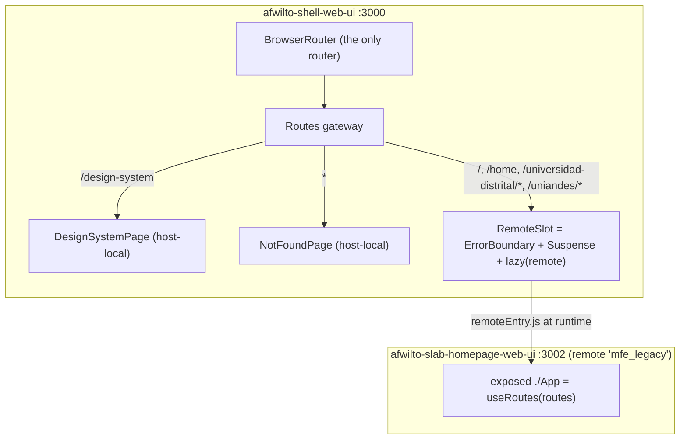
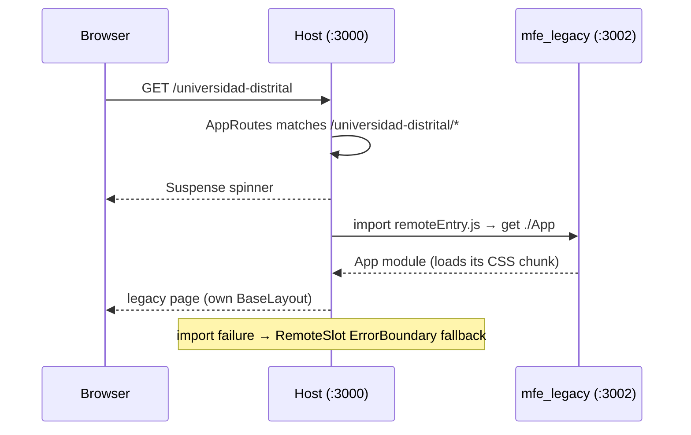

# Spec 02 — Phase 1: Host Shell (`afwilto-shell-web-ui`)

> Status: **Approved** · Phase 1 of the MFE migration
> Depends on: `00-system-architecture.md`, `01-shared-packages.md`

---

## 1. Architecture

### 1.1 Problem & Goal

Create the Module Federation **host**: the single entry point that owns the
browser router and composes remotes by URL prefix. Phase 1 uses the strangler
fig pattern — the whole existing monolith is mounted as one remote
(`mfe_legacy`) so users see zero change while infrastructure lands.

### 1.2 Diagram



### 1.3 Spec amendment vs. migration plan (approved deviation)

The plan said "move the Navbar/Footer/BaseLayout instance into the host".
Reality: every monolith page self-wraps in `BaseLayout` (required for
standalone MFE mode anyway). Amendment: **chrome consistency comes from
`@afwilto/design-system`; each MFE's pages keep rendering `BaseLayout`
themselves.** The host renders chrome only for its own local pages
(DesignSystemPage, NotFoundPage). This avoids double-navbar during the
strangler transition and keeps every MFE standalone-runnable for free.

## 2. Module Specifications

| Module | Responsibility | Inputs | Outputs | Dependencies |
|---|---|---|---|---|
| `src/App.tsx` | Root ErrorBoundary + routes | URL | rendered page | design-system |
| `src/router/AppRoutes.tsx` | URL gateway table | location | route element | react-router |
| `src/remotes/RemoteSlot.tsx` | Safe remote mounting | `remote: () => Promise<{default: ComponentType}>` | remote UI, spinner while loading, fallback card on failure | design-system ErrorBoundary/Spinner |
| `src/remotes/remotes.ts` | Registry of federated remotes | env vars | lazy component per remote | Module Federation runtime |
| `src/pages/DesignSystem` | Token/component showcase (moved from monolith) | — | showcase page | design-system |
| `src/pages/NotFound` | 404 (moved from monolith) | — | 404 page | design-system |
| monolith changes | Become remote `mfe_legacy` | — | `./App` exposing `useRoutes` | `@module-federation/vite` |

## 3. Interfaces

### 3.1 Module Federation contracts

Host `vite.config.ts`:

```ts
federation({
  name: 'shell',
  remotes: {
    mfe_legacy: {
      type: 'module',
      name: 'mfe_legacy',
      entry: env.VITE_REMOTE_LEGACY_URL ?? 'http://localhost:3002/remoteEntry.js',
    },
  },
  shared: { react: { singleton: true }, 'react-dom': { singleton: true }, 'react-router-dom': { singleton: true } },
})
```

Remote (monolith) `vite.config.ts`:

```ts
federation({
  name: 'mfe_legacy',
  filename: 'remoteEntry.js',
  exposes: { './App': './src/App.tsx' },
  shared: { ...same singletons... },
})
```

**Router contract:** an exposed `./App` renders `<Routes>`/`useRoutes` only —
never `createBrowserRouter`/`<BrowserRouter>`. The standalone entry
(`main.tsx`) wraps `<App/>` in `<BrowserRouter>` itself; `main.tsx` is not
exposed, so the router is never duplicated under the host.

**CSS contract:** each remote's exposed `App.tsx` imports the app's own
`index.css` so Tailwind utilities for its pages ship with the remote chunk.
Duplicated `@theme` tokens across host/remote CSS are identical by
construction (single source: `@afwilto/design-system/styles.css`).

### 3.2 URL gateway (Phase 1 state)

| Path | Target |
|---|---|
| `/design-system` | host DesignSystemPage |
| `/*` (everything else) | `mfe_legacy/App` (its own `*` route serves the 404) |

`/design-system` is removed from the monolith's route table (moved, per plan).

**Why a root catch-all for legacy:** the legacy route table uses absolute
paths (`/universidad-distrital/...`); React Router only matches descendant
`useRoutes` tables from the mount point, so the legacy remote must mount at
`/*`. In later phases, specific remote routes (`/slab`, …) are added *above*
the `/*` entry — React Router ranks them higher — and legacy keeps shrinking
until `/*` flips to the host NotFoundPage at decommission.

### 3.3 Data format

No backend calls from the host. Remote loading is ESM over HTTP
(`remoteEntry.js`, `type: 'module'`).

## 4. Data Model

None. The host holds no domain data — only the remote registry (name → entry
URL from `VITE_REMOTE_*_URL` env vars with localhost defaults).

## 5. Processing Flows



## 6. Business Logic

- Route matching is longest-prefix-explicit: host lists specific prefixes
  before the `*` catch-all (rule carried from monolith CLAUDE.md §6.3).
- RemoteSlot must isolate failures: a rejected remote import or a render error
  inside a remote never unmounts the rest of the shell.

## 7. Non-Functional Requirements

- **Performance:** shared singletons ensure exactly one React/ReactDOM/Router
  copy; remotes load on first navigation into their slice.
- **Availability:** RemoteSlot ErrorBoundary per slice.
- **Maintainability:** adding a remote = one registry entry + one route line.
- **Security:** remote URLs configurable via env; no secrets in code.

## 8. Technologies

Vite 8, `@module-federation/vite`, React 19, react-router-dom v7,
Tailwind v4, `@afwilto/design-system` (workspace), Vitest + jsdom + RTL.

## 9. Error Handling

| Failure | Behavior |
|---|---|
| remoteEntry unreachable | lazy import rejects → RemoteSlot ErrorBoundary fallback ("section failed to load", Try again + Go home) |
| Remote render error | same boundary; host chrome unaffected |
| Unknown URL | host NotFoundPage |
| Slow remote | Suspense full-page spinner on `bg-surface-base` |

## 10. Assumptions & Constraints

- Remotes must be **built** (`vite build`) to serve `remoteEntry.js`; plain
  `vite dev` on a remote may not emit it — dev workflow: `build --watch` +
  `preview` for remotes, `vite dev` for the host (verified in Phase 1).
- Monolith moves to port 3002 (its allocated MFE port); host takes 3000.
- react-router v7 is the actual version (plan said v6); `RouteObject[]` +
  `useRoutes` API is compatible.
- The monolith stays deployable standalone at any time.

## 11. Acceptance Criteria

1. **AC-1** Host at `/design-system` renders the showcase (host-local, no
   remote involved).
2. **AC-2** Host NotFoundPage renders the 404 UI (unit test); it takes over
   the `*` route at decommission (Phase 8), since legacy owns `/*` until then.
3. **AC-3** Host at `/`, `/home`, `/universidad-distrital/x`, `/uniandes`
   mounts the legacy remote slot (verified with a mocked remote module).
4. **AC-4** While the remote chunk is pending, a Spinner renders; if the
   remote import rejects, the ErrorBoundary fallback renders instead of a
   crash.
5. **AC-5** Monolith `routes` no longer contain `/design-system`; its `App`
   renders inside a plain `<MemoryRouter>` (i.e. no nested router).
6. **AC-6** `pnpm --filter afwilto-shell-web-ui build` and
   `pnpm --filter afwilto-slab-homepage-web-ui build` both exit 0; the
   monolith build emits `remoteEntry.js`.
7. **AC-7** All workspace tests pass (`pnpm -r test`).
