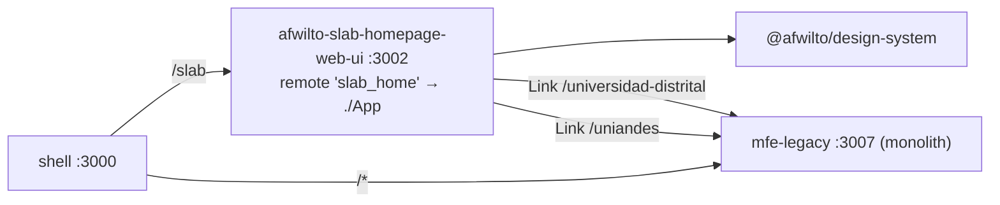

# Spec 03 — Phase 2: Slab Homepage MFE (`afwilto-slab-homepage-web-ui`)

> Status: **Approved** · Phase 2 of the MFE migration
> Depends on: `00-system-architecture.md`, `02-shell-host.md`

---

## 1. Architecture

### 1.1 Problem & Goal

`/slab` must be owned by a small dedicated MFE showing the software-lab
landing (UD + MATI university cards). The legacy monolith keeps serving all
other routes until Phases 3–7 strip them.

### 1.2 Diagram

### 1.3 Naming decision (documented deviation)

The plan re-scopes the existing monolith in place. Because both the legacy
remote and the new slab MFE must coexist in one pnpm workspace during the
transition, the **monolith's package name becomes `mfe-legacy`** (dir
unchanged) **and it moves to port 3007**; the new app takes the canonical
name `afwilto-slab-homepage-web-ui` and its allocated port 3002. At Phase 8
the legacy dir is archived — no rename needed then.

## 2. Module Specifications

| Module | Responsibility | Inputs | Outputs | Dependencies |
|---|---|---|---|---|
| `src/App.tsx` | Exposed remote root — renders SlabPage | — | slab landing | SlabPage |
| `src/pages/Slab/SlabPage.tsx` | Hero + university cards (from monolith HomePage) | `data.ts` INFO objects | landing UI | design-system, react-router `Link` |
| `src/pages/Slab/data.ts` | UD_INFO / UNIANDES_INFO card data | — | typed constants | none |

## 3. Interfaces

- Federation: `name: 'slab_home'`, `exposes: { './App': './src/App.tsx' }`,
  shared singletons react/react-dom/react-router-dom, `remoteEntry.js` @ 3002.
- Host gateway adds `/slab → slab_home/App` **above** the `/*` legacy entry;
  host default remote URL `VITE_REMOTE_SLAB_HOME_URL ?? http://localhost:3002/remoteEntry.js`,
  legacy default flips to `http://localhost:3007/remoteEntry.js`.
- App renders no internal router (single-page MFE); standalone entry wraps in
  `BrowserRouter`.
- Navigation contract: card links point at `/universidad-distrital` and
  `/uniandes` (legacy-owned) until Phases 4–5 change them to `/slab/ud` and
  `/slab/mati`.

## 4. Data Model

`UniversityInfo` (static): name, acronym, career, location, type, founded,
accentColor (hex), goldColor (hex), logoUrl. Constraint: accent colours are
applied via `style={{}}`, never Tailwind classes (dynamic brand colours).

## 5. Processing Flows

User → `/slab` → host matches `/slab` → RemoteSlot lazy-loads
`slab_home/App` (spinner meanwhile) → SlabPage renders → card click
navigates to a legacy-owned URL via client-side `Link`.

## 6. Business Logic

Pure presentation. Only rule: exactly two university cards (UD, Uniandes/MATI)
with brand-accurate accent colours and stats.

## 7. Non-Functional Requirements

No backend calls; bundle limited to page + design system; must run standalone
(`pnpm --filter afwilto-slab-homepage-web-ui dev`).

## 8. Technologies

Same stack as host (Vite 8, React 19, Tailwind v4, MF, Vitest+RTL).

## 9. Error Handling

None beyond host RemoteSlot isolation (no I/O in this MFE).

## 10. Assumptions & Constraints

- Legacy keeps `/` and `/home` until Phase 3.
- URL `/slab` is NEW (nothing breaks); `/` keeps showing legacy HomePage.
- Uniandes logo is a remote URL (unchanged from monolith).

## 11. Acceptance Criteria

1. **AC-1** SlabPage renders the hero ("AFWILTO", "Software Lab") and both
   university cards ("Universidad Distrital…", "Universidad de los Andes").
2. **AC-2** UD card links to `/universidad-distrital`; Uniandes card links to
   `/uniandes`.
3. **AC-3** Exposed `App` renders SlabPage inside an external router (no
   nested router).
4. **AC-4** Host at `/slab` mounts the slab remote slot; `/` still mounts the
   legacy slot (host tests with mocked registry).
5. **AC-5** `pnpm --filter afwilto-slab-homepage-web-ui build` emits
   `remoteEntry.js`; host build passes; all workspace tests green.
