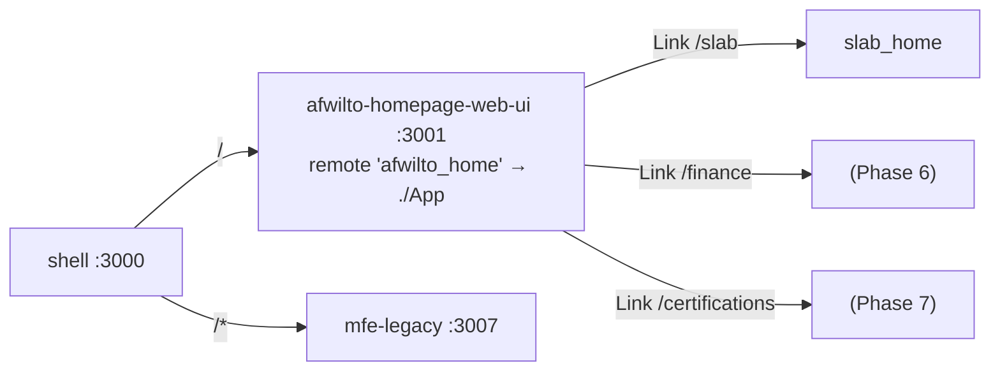

# Spec 04 — Phase 3: afwilto Root Homepage MFE (`afwilto-homepage-web-ui`)

> Status: **Approved** · Phase 3 of the MFE migration
> Depends on: `00-system-architecture.md`, `02-shell-host.md`

---

## 1. Architecture

### 1.1 Problem & Goal

`/` becomes the top-level personal-brand landing — the entry point for the
whole afwilto ecosystem, linking to every sub-product. New MFE; must be the
fastest-loading one (zero backend calls, minimal bundle).

### 1.2 Diagram

## 2. Module Specifications

| Module | Responsibility | Inputs | Outputs | Dependencies |
|---|---|---|---|---|
| `src/App.tsx` | Exposed remote root | — | root landing | HomePage |
| `src/pages/Home/HomePage.tsx` | Brand hero + product cards | `PRODUCTS` data | landing UI | design-system, `Link` |
| `src/pages/Home/data.ts` | Product catalog | — | `PRODUCTS: Product[]` | none |

## 3. Interfaces

- Federation: `name: 'afwilto_home'`, `exposes: { './App': './src/App.tsx' }`,
  singletons shared, `remoteEntry.js` @ 3001,
  host env `VITE_REMOTE_AFWILTO_HOME_URL`.
- Host gateway: `/` (index, exact) → `afwilto_home/App`.
- Legacy loses `/` and `/home` routes and its `pages/Home` directory.
- Product card contract: `{ slug, title, description, to, icon, status }`
  where `status: 'live' | 'soon'` — `/finance` and `/certifications` render
  as `soon` until Phases 6–7 land, pointing at their future URLs.

## 4. Data Model

`Product` (static TS): slug (kebab, unique), title, description, `to` (URL
prefix owned by the target MFE), icon (emoji — no icon library), status.
Three products: software-lab (`/slab`, live), financial-status (`/finance`,
soon), certifications (`/certifications`, soon).

## 5. Processing Flows

`/` → host matches index route → RemoteSlot lazy-loads `afwilto_home/App`
(spinner) → HomePage renders → card click client-navigates to the target
prefix, which the host resolves to the owning remote.

## 6. Business Logic

Pure presentation. Rule: a `soon` product card is rendered non-clickable with
a "Coming soon" badge; a `live` card navigates.

## 7. Non-Functional Requirements

Fastest MFE: no backend calls, no data fetching, single page, bundle =
page + design system. Standalone runnable on :3001.

## 8. Technologies

Same stack as Spec 03.

## 9. Error Handling

None beyond host RemoteSlot isolation.

## 10. Assumptions & Constraints

- `/home` ceases to exist (was an alias); it now falls through to legacy's
  404. Accepted.
- `/finance`, `/certifications` are dead prefixes until Phases 6–7 — hence
  the `soon` status rather than broken links.

## 11. Acceptance Criteria

1. **AC-1** HomePage renders brand hero (h1 containing "afwilto") and exactly
   3 product cards: Software Lab, Financial Status, Certifications.
2. **AC-2** The Software Lab card links to `/slab`; `soon` cards render a
   "Coming soon" badge and no link to their prefix.
3. **AC-3** Exposed `App` renders inside an external router.
4. **AC-4** Host `/` mounts the afwilto_home slot (mocked); legacy routes
   table no longer contains `/` or `/home`.
5. **AC-5** Build emits `remoteEntry.js`; host + legacy builds pass; all
   workspace tests green.
