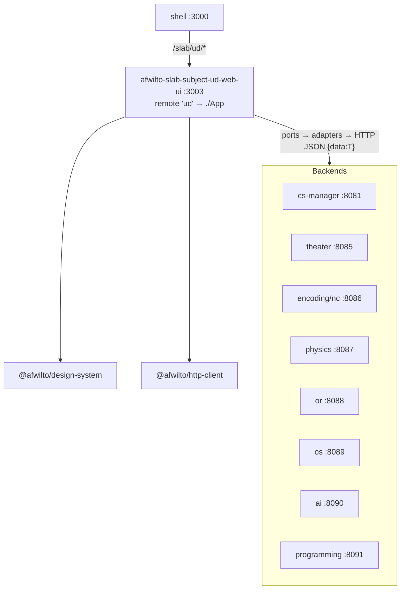
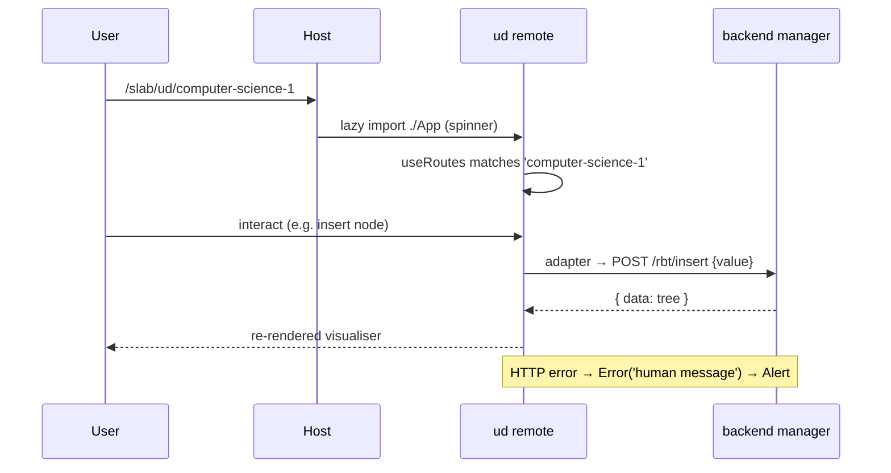

# Spec 05 — Phase 4: Universidad Distrital MFE (`afwilto-slab-subject-ud-web-ui`)

> Status: **Approved** · Phase 4 of the MFE migration
> Depends on: `00-system-architecture.md`, `02-shell-host.md`

---

## 1. Architecture

### 1.1 Problem & Goal

All UD academic content (`/universidad-distrital/**`, 15 built subjects + 6
stubs, 30 service ports, 30 HTTP adapters, DI container) moves out of the
legacy monolith into a dedicated MFE owning `/slab/ud/**`.
**Accepted breaking URL change:** `/universidad-distrital/**` → `/slab/ud/**`.

### 1.2 Diagram

### 1.3 Structure decision (documented amendment)

The plan proposed regrouping pages into `features/{cs,programming,os,ai,networks,databases,or,physics}`.
Amendment: the MFE **keeps the existing `pages/UniversidadDistrital/subjects/*`
layout** (already one directory per subject, lazy-chunked per route). A pure
directory reshuffle of ~100 files adds rename risk with no isolation gain —
lazy chunks already give development-time independence. Feature↔backend
boundaries are tracked in the table below (§2). Revisit only on the plan's
split trigger (>2 MB gzip or divergent deploy cadence).

### 1.4 Static asset ownership (integration rule)

Root-relative asset URLs (`/logos/…`) resolve against the **host** origin when
an MFE is federated. Therefore the host's `public/` owns shared static assets
(logos, icons); each MFE keeps copies only for standalone mode.

## 2. Module Specifications

| Feature group | Subjects/pages | Backend | Ports (adapters 1:1) |
|---|---|---|---|
| cs | CS1 (RBT), CS2 (14 algorithm pages), CS3 (CriticalPath, TruthTable) | cs-manager :8081 | IRBTService, IChromaticGraphService, IHashTableService, IBTreeService, ITrieService, ILCRSService, IHuffmanService, IAVLCursorService, IGraphAlgoService, IGraphTraversalService, IHashDispersionService, IHashFunctionService, ITopologicalSortService, ICriticalPathService, ITruthTableService |
| programming | TicTacToe, Scrabble, Chess | programming-manager :8091 | ITicTacToeService, IScrabbleService, IChessService |
| os | RoundRobin, MLFQ | os-manager :8089 | IRoundRobinService, IMLFQService |
| ai | A*, DFS | ai-manager :8090 | IAStarService, IDFSService |
| networks | Weather (NC1), Encoding (NC2), MailClient (NC3) | network-comm/encoding :8086 | IWeatherStationService, IEncodingService, IMailClientService |
| databases | DB1 stub, Theater app (DB2) | theater-manager :8085 | ITheaterService |
| or | GraphicalMethod, MixedInteger | or-manager :8088 | IGraphicalMethodService, IMixedIntegerService |
| physics | Physics Lab wizard | physics-manager :8087 | IPhysicsLabService |

Cross-cutting modules: `pages/UniversidadDistritalPage` (landing grid + data),
`pages/Subject/SubjectPage` (template; university="distrital"),
`pages/NotFound`, `di/container.ts` (composition root, all 30 services),
`di/ServiceProvider` (`useServices()`), `router/routes.tsx` (**relative**
paths), `App.tsx` (ErrorBoundary → ServiceProvider → `useRoutes`).

Inputs/outputs & dependency rules are unchanged from the monolith CLAUDE.md:
pages consume ports via `useServices()` only; adapters get `IHttpClient`
injected; container is the only file knowing concrete types.

## 3. Interfaces

- Federation: `name: 'ud'`, `exposes: { './App': './src/App.tsx' }`,
  singletons shared, `remoteEntry.js` @ 3003, host env `VITE_REMOTE_UD_URL`.
- Host gateway adds `/slab/ud/*` above the legacy catch-all.
- **Internal routes are relative** (`''`, `computer-science-1`,
  `computer-science-2/b-tree`, `:subjectSlug`, `*`) so the app mounts under
  any prefix. All intra-app `Link`s use absolute `/slab/ud/...` URLs.
- Standalone entry serves the same URL space:
  `<Route path="/slab/ud/*" element={<App/>}>` + redirect from `/`.
- Backend contract unchanged: JSON envelope `{ data: T }`, adapters unwrap and
  translate errors to human messages; base URLs from `VITE_*_URL` env vars
  (defaults localhost:8081–8091 as in the monolith container).

## 4. Data Model

Static catalogs (moved verbatim): `UD_INFO`, `UD_SUBJECTS` (20 subjects:
slug PK, title, number, category ∈ closed union, description, icon),
`UD_CATEGORY_STYLE`, per-subject project arrays (e.g. `CS2_PROJECTS` with
slug PK, complexities, concepts, plannedEndpoints). Domain response types
live in each port file. No persistent frontend data.

## 5. Processing Flows

## 6. Business Logic

Unchanged from monolith: input validation before backend calls, presentation
state machines (wizard steps, schedulers, game boards), catalog filtering by
category. Domain algorithms stay in backends.

## 7. Non-Functional Requirements

Lazy chunk per subject page (route-level `React.lazy`); split trigger ~2 MB
gzip; standalone runnable on :3003; no secrets (env-configured URLs).

## 8. Technologies

Same stack (Vite 8, React 19, TS strict + erasableSyntaxOnly, Tailwind v4,
MF, Vitest+RTL). Backends: Go services (unchanged).

## 9. Error Handling

Adapter layer translates HTTP status → `Error('<human message>')`; pages show
`Alert variant="error"`. Unknown `/slab/ud/**` path → app-local 404 route.
Remote load failure → host RemoteSlot fallback.

## 10. Assumptions & Constraints

- Old `/universidad-distrital/**` URLs 404 in legacy (accepted).
- Legacy keeps its UD source as dead code until Phase 8 archive (only routes
  are stripped) — avoids breaking its SubjectPage which serves `/uniandes/*`
  until Phase 5.
- SubjectPage copy retains the uniandes branch (+ its data file) until the
  MATI MFE lands; UD app only mounts `university="distrital"`.
- The slab homepage UD card now links to `/slab/ud`.

## 11. Acceptance Criteria

1. **AC-1** UD app route table is fully relative (no path starts with `/`)
   and contains the landing (`''`), all 15 built subject slugs, the
   `:subjectSlug` fallback and `*`.
2. **AC-2** App at `/slab/ud` (standalone router) renders the UD landing
   (subject grid with "Universidad Distrital" header).
3. **AC-3** App at `/slab/ud/<unknown-slug>` renders SubjectPage's
   "Subject not found" (for param routes) and `*` renders the 404 page for
   deeper unknown paths.
4. **AC-4** Intra-app links use `/slab/ud/...` (landing subject cards).
5. **AC-5** Host `/slab/ud/*` mounts the ud slot (mocked); slab homepage UD
   card links to `/slab/ud`; legacy routes contain no `/universidad-distrital`
   entries.
6. **AC-6** `di/container.ts` exposes all 30 services; a container test
   verifies every ServiceContainer key is instantiated.
7. **AC-7** UD app + host + legacy + slab builds pass; UD emits
   `remoteEntry.js`; all workspace tests green.
