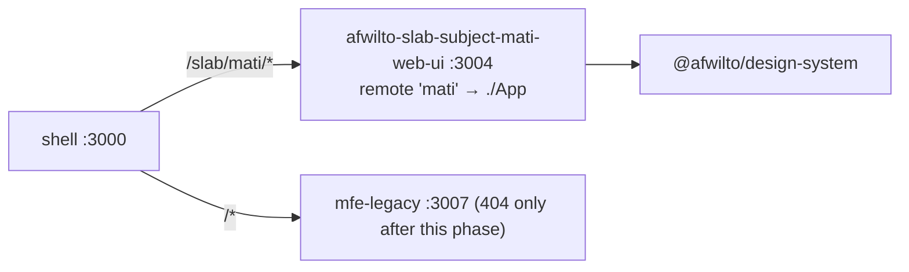

# Spec 06 — Phase 5: MATI MFE (`afwilto-slab-subject-mati-web-ui`)

> Status: **Approved** · Phase 5 of the MFE migration
> Depends on: `00-system-architecture.md`, `02-shell-host.md`, `05-ud-subjects-mfe.md`

---

## 1. Architecture

### 1.1 Problem & Goal

MATI/Uniandes content moves from the legacy monolith to a small dedicated MFE
owning `/slab/mati/**`. Today it is a landing page (subject grid) plus
placeholder subject pages; it grows in place as MATI modules are built.
**Accepted breaking URL change:** `/uniandes/**` → `/slab/mati/**`.

### 1.2 Diagram

## 2. Module Specifications

| Module | Responsibility | Inputs | Outputs | Dependencies |
|---|---|---|---|---|
| `src/pages/Mati/MatiPage.tsx` | Landing: MATI subject grid + category filter (from UniandesPage) | `data.ts` | landing UI | design-system, `Link` |
| `src/pages/Mati/data.ts` | UNIANDES_INFO, UNIANDES_SUBJECTS, category styles | — | typed constants | none |
| `src/pages/Subject/SubjectPage.tsx` | Subject template, **uniandes-only trim** (no `university` prop) | `slug` param | subject page / "Subject not found" | data.ts, design-system |
| `src/router/routes.tsx` | Relative table: `''`, `:subjectSlug`, `*` | — | RouteObject[] | pages |
| `src/App.tsx` | ErrorBoundary + `useRoutes` (no DI — no backend yet) | — | routed UI | router |

## 3. Interfaces

- Federation: `name: 'mati'`, `exposes: { './App': './src/App.tsx' }`,
  singletons shared, `remoteEntry.js` @ 3004, host env `VITE_REMOTE_MATI_URL`.
- Host gateway adds `/slab/mati/*`; slab homepage Uniandes card links to
  `/slab/mati`.
- Internal links absolute `/slab/mati/...`; routes relative; standalone entry
  serves `/slab/mati/*` + redirect (same pattern as UD, Spec 05 §3).
- No backend, no DI container yet — `features/` appear as MATI content lands.

## 4. Data Model

`UNIANDES_SUBJECTS`: slug PK, title, category ∈ MATI category union,
description, icon. `UNIANDES_INFO` as in Spec 03 §4.

## 5. Processing Flows

`/slab/mati` → host lazy-mounts mati remote → MatiPage grid →
`/slab/mati/<slug>` → SubjectPage placeholder ("Content in Progress") or
"Subject not found" for unknown slugs.

## 6. Business Logic

Category filter pills on the landing; placeholder card until real content.

## 7. Non-Functional Requirements

Tiny bundle (landing + template); standalone on :3004; grows without touching
other MFEs.

## 8. Technologies

Same stack (Vite 8, React 19, Tailwind v4, MF, Vitest+RTL).

## 9. Error Handling

Unknown slug → "Subject not found" with back link; remote failure isolated by
host RemoteSlot.

## 10. Assumptions & Constraints

- After this phase the legacy remote serves only its 404 catch-all; it stays
  as the `/*` safety net until Phase 8.
- Old `/uniandes/**` URLs 404 (accepted).
- Uniandes logo stays a remote URL.

## 11. Acceptance Criteria

1. **AC-1** Route table is relative and contains `''`, `:subjectSlug`, `*`.
2. **AC-2** App at `/slab/mati` renders the MATI landing (grid header +
   "Universidad de los Andes" context).
3. **AC-3** `/slab/mati/<known-slug>` renders the subject placeholder;
   `/slab/mati/not-real` renders "Subject not found".
4. **AC-4** Landing subject cards link into `/slab/mati/...`.
5. **AC-5** Host `/slab/mati/*` mounts the mati slot; slab Uniandes card
   links to `/slab/mati`; legacy routes contain no `/uniandes` entries.
6. **AC-6** Build emits `remoteEntry.js`; all builds + workspace tests green.
