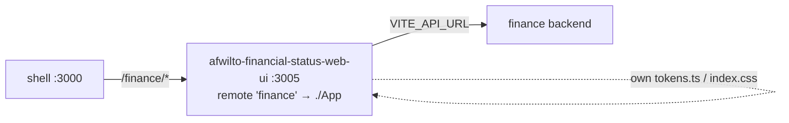

# Spec 07 — Phase 6: Finance MFE (`afwilto-financial-status-web-ui`)

> Status: **Approved** · Phase 6 of the MFE migration
> Depends on: `00-system-architecture.md`, `02-shell-host.md`

---

## 1. Architecture

### 1.1 Problem & Goal

Wrap the existing `personal-financial-status/afwt-financial-status-frontend`
app as a federated remote owning `/finance/**` — **without refactoring its
internals** (feature-based architecture, own visual identity, recharts +
lucide-react stay).

### 1.2 Diagram

### 1.3 Integration decisions (per plan §4.6 + chrome amendment)

- Source is **copied** into `apps/` (workspace member); the original repo
  stays untouched at its current location.
- Its own `AppLayout` (sidebar chrome) is **kept** — consistent with the
  per-MFE chrome model (Spec 02 §1.3); token alignment is a later pass.
- Only federation-contract changes are made: router extraction, path
  prefixing, remote config, test harness.

## 2. Module Specifications

| Module | Change | Responsibility |
|---|---|---|
| `src/App.tsx` | providers keep, `BrowserRouter` **removed**, routes become relative | exposed remote root |
| `src/main.tsx` | adds `BrowserRouter` + `/finance/*` mount + redirect | standalone entry |
| `src/components/Sidebar.tsx`, detail/dashboard pages | absolute nav targets prefixed `/finance/...` | navigation |
| everything else (features, context, services, lib, tokens) | **unchanged** | finance domain |

## 3. Interfaces

- Federation: `name: 'finance'`, `exposes: { './App': './src/App.tsx' }`,
  singletons shared, `remoteEntry.js` @ 3005, host env
  `VITE_REMOTE_FINANCE_URL`.
- Host gateway adds `/finance/*`; root homepage Finance card flips to `live`.
- Backend: `VITE_API_URL` (its existing `lib/api.ts` contract, JSON).
- Route map (relative): `''` dashboard, `incomes`, `expenses`, `goals`,
  `goals/:id`, `credits`, `credits/:id`, `design`.

## 4. Data Model

Owned by the finance app (transactions, goals, credits via its context
providers + services). Not re-modeled here — no internal refactor.

## 5. Processing Flows

`/finance` → host lazy-mounts finance remote → providers hydrate via services
(`VITE_API_URL`) → AppLayout + routed page. Standalone mode identical under
the same `/finance` prefix.

## 6. Business Logic

Unchanged finance domain logic (budgets, goals, credits). Out of scope here.

## 7. Non-Functional Requirements

Bundle isolated (recharts/lucide only in this remote); style divergence
accepted initially; standalone on :3005.

## 8. Technologies

React 19, Vite 8, Tailwind v4 (own theme), recharts, lucide-react, MF,
Vitest+RTL (added).

## 9. Error Handling

Existing app behavior; remote-load failure isolated by host RemoteSlot.

## 10. Assumptions & Constraints

- Finance backend runs separately (`VITE_API_URL`); pages must still render
  without it (providers fetch async).
- Non-goal: token alignment with @afwilto/design-system, internal refactor.

## 11. Acceptance Criteria

1. **AC-1** Exposed `App` has no `BrowserRouter`; route table relative
   (`''`, `incomes`, `expenses`, `goals`, `goals/:id`, `credits`,
   `credits/:id`, `design`).
2. **AC-2** App at `/finance` (external router) renders the dashboard inside
   AppLayout; `/finance/incomes` renders the incomes page.
3. **AC-3** Sidebar links target `/finance/...`.
4. **AC-4** Host `/finance/*` mounts the finance slot; root homepage Finance
   card is `live` linking `/finance`.
5. **AC-5** Build emits `remoteEntry.js`; all builds + workspace tests green.
