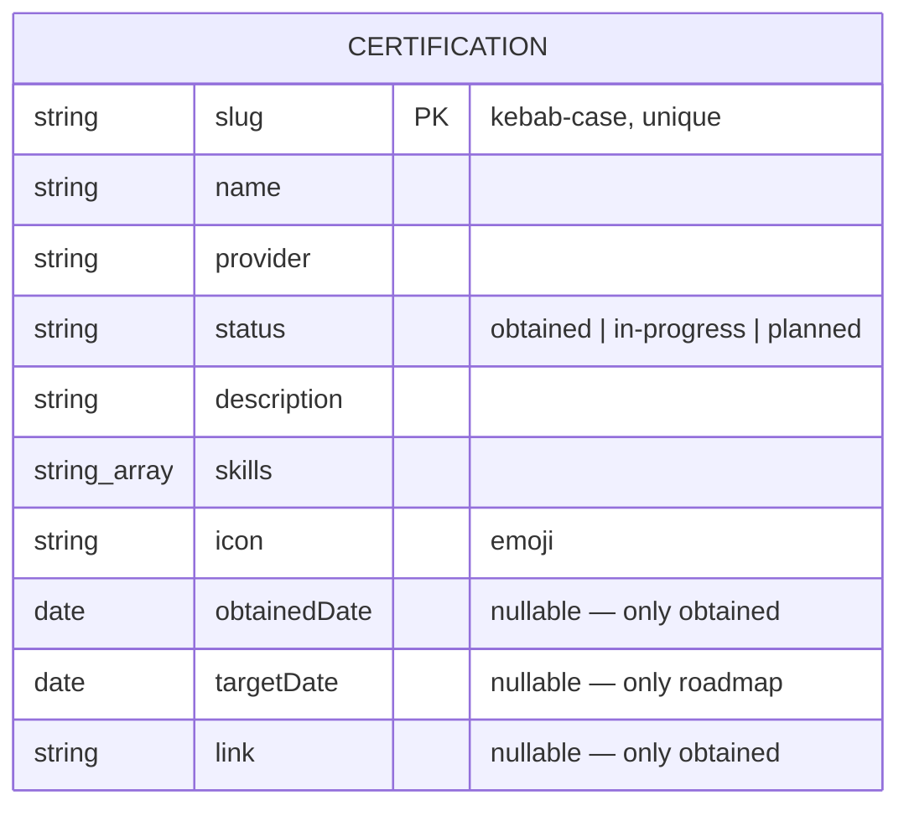

# Spec 08 — Phase 7: Certifications MFE (`afwilto-certifications-web-ui`)

> Status: **Approved** · Phase 7 of the MFE migration
> Depends on: `00-system-architecture.md`, `02-shell-host.md`

---

## 1. Architecture

### 1.1 Problem & Goal

New product owning `/certifications/**`: a catalog of obtained certifications
and a learning roadmap. **No backend initially** — data lives in TypeScript
files, but the hexagonal boundary still applies: pages consume
`ICertificationService` via `useServices()`, backed by a static adapter, so a
future HTTP backend swaps in at the composition root without touching pages.

### 1.2 Diagram

```mermaid
flowchart LR
    HOST["shell :3000"] -->|"/certifications/*"| CERT["afwilto-certifications-web-ui :3006<br/>remote 'certifications' → ./App"]
    subgraph CERT_APP["inside the MFE"]
        PAGES["Catalog · Roadmap · Detail"] -->|useServices()| PORT["ICertificationService"]
        PORT --> STATIC["StaticCertificationAdapter (data.ts)"]
        STATIC -.->|future swap in container.ts| HTTP["CertificationHttpAdapter (later)"]
    end
    CERT --> DS["@afwilto/design-system"]
```

## 2. Module Specifications

| Module | Responsibility | Inputs | Outputs | Dependencies |
|---|---|---|---|---|
| `application/ports/ICertificationService.ts` | Domain contract + `Certification` types | — | interface | none |
| `infrastructure/adapters/static/StaticCertificationAdapter.ts` | Implements the port over `CERTIFICATIONS` data | — | Promise-based results | port, data |
| `infrastructure/data/certifications.ts` | The catalog/roadmap dataset | — | `CERTIFICATIONS: Certification[]` | none |
| `di/container.ts` + `di/ServiceProvider.tsx` | Composition root + `useServices()` | — | `{ certificationService }` | adapter |
| `pages/Catalog/CatalogPage.tsx` | Grid of obtained certs | service | catalog UI | design-system |
| `pages/Roadmap/RoadmapPage.tsx` | Goal list with status | service | roadmap UI | design-system |
| `pages/Detail/CertDetailPage.tsx` | One cert (skills, relevance, link) | `:certSlug` | detail UI / not-found | design-system |

## 3. Interfaces

### 3.1 Port contract

```ts
type CertificationStatus = 'obtained' | 'in-progress' | 'planned'
interface Certification {
  slug: string; name: string; provider: string
  status: CertificationStatus
  description: string; skills: string[]
  icon: string
  obtainedDate?: string   // ISO yyyy-mm-dd, only when obtained
  targetDate?: string     // ISO, only for roadmap items
  link?: string           // credential URL, only when obtained
}
interface ICertificationService {
  getCatalog(): Promise<Certification[]>            // obtained, newest first
  getRoadmap(): Promise<Certification[]>            // in-progress before planned
  getBySlug(slug: string): Promise<Certification | null>  // null = not found (valid empty, not an error)
}
```

- Federation: `name: 'certifications'`, `exposes: { './App': './src/App.tsx' }`,
  `remoteEntry.js` @ 3006, host env `VITE_REMOTE_CERTIFICATIONS_URL`.
- Routes (relative): `''` catalog, `roadmap`, `:certSlug`, `*` 404.
- Host gateway adds `/certifications/*`; root homepage card flips to `live`.

## 4. Data Model



Constraints: slugs unique (tested); optional fields nullable rather than
fabricated; dates ISO `yyyy-mm-dd`.

## 5. Processing Flows

`/certifications` → host lazy-mounts remote → CatalogPage calls
`getCatalog()` → adapter filters+sorts static data → grid. Card click →
`/certifications/<slug>` → `getBySlug` → detail or not-found view.

## 6. Business Logic

- Catalog = `status === 'obtained'`, sorted by `obtainedDate` descending.
- Roadmap = `in-progress` then `planned` (stable within group).
- `getBySlug` returns `null` for unknown slugs — pages render a not-found
  state with a back link (no throw: absence is a valid empty result).

## 7. Non-Functional Requirements

No network I/O (static adapter resolves immediately); standalone on :3006;
swapping to a backend touches only `container.ts`.

## 8. Technologies

Same stack (Vite 8, React 19, TS strict, Tailwind v4, MF, Vitest+RTL).

## 9. Error Handling

Unknown slug → not-found view (valid empty). Adapter never throws today; a
future HTTP adapter follows the Spec 01 error-translation contract.

## 10. Assumptions & Constraints

- Dataset is illustrative and edited by hand until a backend exists.
- Non-goals: auth, filtering/search, backend, badge image hosting.

## 11. Acceptance Criteria

1. **AC-1** `getCatalog()` returns only `obtained` certs sorted newest-first.
2. **AC-2** `getRoadmap()` returns `in-progress` items before `planned` ones
   and no `obtained` items.
3. **AC-3** `getBySlug('<known>')` resolves the cert; `getBySlug('nope')`
   resolves `null`.
4. **AC-4** Dataset slugs are unique.
5. **AC-5** Catalog page renders one card per obtained cert; roadmap page
   shows status badges; detail page renders name+skills for a known slug and
   a not-found state for an unknown one.
6. **AC-6** Route table relative (`''`, `roadmap`, `:certSlug`, `*`); pages
   consume the service only via `useServices()`.
7. **AC-7** Host `/certifications/*` mounts the slot; root homepage card is
   `live`; build emits `remoteEntry.js`; all workspace tests green.
