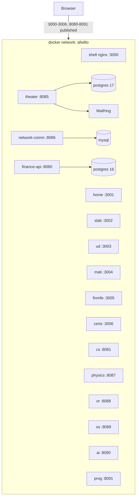

# Spec 10 — Single `docker compose up -d` for the Whole Platform

> Status: **Proposed (plan — not yet implemented)**
> Depends on: `00-system-architecture.md` (final gateway per Spec 09)

---

## 1. Problem & Goal

One command — `docker compose up -d` — must start the complete system:
host shell, all 6 MFEs, all 8 academic backend managers, the finance backend,
and every database/side service they need, with working networking, CORS and
health-gated startup order.

**Non-goals:** production hosting (TLS, domains, CDN), CI image publishing,
hot-reload dev containers (the existing per-service compose files keep that
role), Kubernetes.

## 2. Inventory (verified on disk)

### Frontend (7 images — new Dockerfiles needed)

| App | Port | Serves |
|---|---|---|
| shell (host) | 3000 | SPA gateway |
| afwilto-homepage | 3001 | remoteEntry.js + assets |
| slab-homepage | 3002 | idem |
| ud-subjects | 3003 | idem |
| mati | 3004 | idem |
| finance MFE | 3005 | idem |
| certifications | 3006 | idem |

### Backend (Dockerfiles already exist)

| Service | Stack | Host port → container | Extra services |
|---|---|---|---|
| computer-science | Go | 8081 → 8081 | — (CORS `*` already) |
| data-bases (theater) | .NET | 8085 → 8080 | **Postgres 17** (+seed), **MailHog** (8025/1025), JWT+SMTP env |
| network-communication | PHP Laravel | 8086 → 8000 | **MySQL/MariaDB** (3307→3306), env_file/APP_KEY |
| physics | Kotlin/Gradle | 8087 → 8080 | — |
| operations-research | Kotlin/Gradle | 8088 → 8080 | — |
| operative-system | Rust | 8089 → 8080 | — |
| artificial-intelligence | Python | 8090 → 8080 | — |
| programming | Java/Maven | 8091 → 8080 | — |
| finance backend | Go | 8080 → 8080 | **Postgres 16** (+init/seeds), lives at `../personal-financial-status` |

Port collisions to resolve: the two Postgres instances both claim host 5432
today — in the unified file **no DB publishes a host port** (internal network
only; optional `debug` profile can expose them on 5433/5434).

## 3. Architecture

**Key insight:** all cross-app URLs (`remoteEntry.js` locations, backend base
URLs) are resolved **by the browser**, not container-to-container. So the
baked-in `localhost:{port}` defaults in the MFE builds are correct for a
single-host deployment, provided compose publishes every port listed above.
Container-to-container traffic exists only between an API and its own DB.

## 4. Deliverables

1. **`afwilto-software-lab/docker-compose.yml`** — the single file, ~21
   services, one `afwilto` network, named volumes for the 3 DBs.
2. **`frontend/docker/Dockerfile.mfe`** (one parameterized file, `ARG APP`):
   - build stage: `node:22-alpine` + corepack/pnpm, context = `frontend/`,
     `pnpm install --frozen-lockfile`, `pnpm --filter $APP build`
   - runtime stage: `nginx:alpine`, copy `apps/$APP/dist`
3. **Two nginx configs** in `frontend/docker/`:
   - `nginx.host.conf` — SPA fallback (`try_files $uri /index.html`)
   - `nginx.remote.conf` — same + `Access-Control-Allow-Origin: *` (the host
     page at :3000 imports remote ES modules cross-origin — CORS is required)
4. **`.env.example`** at compose root: DB credentials, JWT secret, published
   ports (all with working defaults so `up -d` needs zero setup).
5. **Smoke script** `scripts/smoke.sh`: curl every published endpoint
   (7 frontends, 9 APIs' health/root) until healthy or timeout.

## 5. Compose file design rules

- `build:` contexts point at each service directory (backend Dockerfiles are
  reused untouched); frontend services share `context: ./frontend` +
  `dockerfile: docker/Dockerfile.mfe` + `args: { APP: <name> }`.
- Finance stack context: `../personal-financial-status/afwt-financial-status-backend`
  (path outside the lab dir — works; see Decision D2).
- DBs get `healthcheck` + APIs `depends_on: condition: service_healthy`.
- Finance API env: `ALLOW_ORIGINS=http://localhost:3000` (today it allows
  only :5173 — without this the finance MFE breaks under the shell).
- Theater/network-comm env vars copied from their existing compose files
  (JWT, SMTP→mailhog, MySQL credentials, APP_KEY via env_file).
- `restart: unless-stopped` everywhere; no DB host ports (debug profile only).

## 6. Verification (acceptance criteria)

1. **AC-1** `docker compose up -d` from a clean state (no volumes) exits 0;
   `docker compose ps` shows all services `running`/`healthy`.
2. **AC-2** `curl localhost:300{1..6}/remoteEntry.js` → 200 with
   `Access-Control-Allow-Origin`; `curl localhost:3000/` and
   `curl localhost:3000/slab/ud/computer-science-1` → 200 (SPA fallback).
3. **AC-3** Browser at `localhost:3000`: root landing loads, `/slab/ud/**`
   subject with a visualiser round-trips to its manager (e.g. RBT insert →
   cs-manager :8081), `/finance` loads data from :8080.
4. **AC-4** Theater app login flow works (Postgres seeded, MailHog reachable
   at :8025); network-comm endpoints respond after MySQL is healthy.
5. **AC-5** `docker compose down && docker compose up -d` is idempotent;
   DB data survives via named volumes.
6. **AC-6** Smoke script passes end-to-end.

## 7. Risks / open questions

- **R1 — untested backend Dockerfiles:** Laravel (APP_KEY, migrations on
  boot?) and .NET (EF migrations vs seed scripts) may need entrypoint tweaks;
  budget per-service debugging.
- **R2 — CORS per manager:** cs-manager allows `*`; the other seven must be
  checked (grep + runtime probe) — fix in env/config, not code, where possible.
- **R3 — build times:** 9 backend images across 6 language toolchains; first
  `up` is slow. Mitigation: none needed for local use.
- **D1 (decision):** publish backend ports (browser needs 8081–8091, 8080) —
  chosen; alternative (reverse-proxy everything through one origin) deferred.
- **D2 (decision):** where the compose file lives. Proposed:
  `afwilto-software-lab/docker-compose.yml` + `git init` at that root
  (ignoring the nested frontend/monolith repos), since that directory is
  currently untracked. Alternative: keep it inside `frontend/` (tracked
  today) with `../backend` contexts.

## 8. Implementation order (each step ends green)

1. Frontend images: Dockerfile.mfe + nginx configs; build all 7 locally;
   verify remoteEntry CORS with curl.
2. Compose skeleton: frontends only → AC-2 passes.
3. Add the 6 stateless managers (cs, physics, or, os, ai, programming) →
   probe each health endpoint.
4. Add theater stack (Postgres+MailHog+API) and network-comm stack (MySQL+API)
   → AC-4.
5. Add finance stack (Postgres+API) with corrected ALLOW_ORIGINS → AC-3
   finance path.
6. `.env.example`, smoke script, README section, full clean-state run → AC-1,
   AC-5, AC-6.
