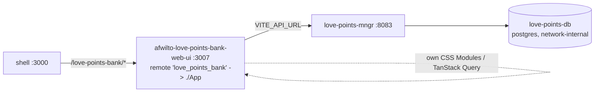

# Spec 15 — Love Points Bank MFE (`afwilto-love-points-bank-web-ui`)

> Status: **Approved** (owner chat approval — implementation authorized)
> Depends on: `00-system-architecture.md`, `02-shell-host.md`
> Precedent: `07-finance-mfe.md` (port an existing standalone app, no internal rewrite)
> **Amendment 2026-10-09 (owner decision): the backend has its own repository.**
> - **New repo:** the Go service, its migrations and `api/openapi.yaml` were extracted, with
>   history, into `backend/afwilto-love-points-bank-mngr`
>   (`git@github.com:AndresFWilT/afwilto-love-points-bank-mngr.git`). `backend/` moved to the
>   repo root and `data-base/migrations` to `migrations/`.
> - **Platform compose:** the `afwilto-platform-iac` compose builds `love-points-mngr` and mounts
>   `love-points-migrate`'s migrations from that repo.
> - **Frontend:** it lives only as the MFE in this monorepo.
> - **Old checkout:** the sibling `../love-points-bank` is no longer used by the platform and
>   is kept locally as an archive. Where this spec says that repo is the source of truth for
>   the backend, read the new manager repo instead.

---

## 1. Architecture

### 1.1 Problem & Goal

`love-points-bank` ("Banco de Puntitos") is a mature, independently-built app living at
`../love-points-bank` (sibling of the lab, not a subdirectory of it): a private points
ledger between two people, with a v1 (award/edit/void/balances) and v2
(catalog/redemption) already implemented — React 18 + Vite frontend (TanStack Query,
React Hook Form + Zod, CSS Modules), hexagonal Go backend (`internal/domain` →
`internal/app` → `internal/adapter`), Postgres, its own `docs/specs/NNN-*.md` SDD
practice and 90%/80% domain/app coverage gates. It has no relationship to the lab's
`@afwilto/design-system`.

Goal: wrap it as a federated remote owning `/love-points-bank/**`, reachable from the
shell, with a live card on the root homepage — **without refactoring its internals**
(visual identity, TanStack Query, RHF+Zod, CSS Modules all stay), exactly as Spec 07 did
for finance. Certifications' from-scratch rebuild (Spec 08→11) is the wrong precedent
here: this app is already tested and working; rewriting it against the shared design
system would discard verified behavior for no functional gain.

### 1.2 Diagram

### 1.3 Integration decisions

- Source is **copied** into `frontend/apps/afwilto-love-points-bank-web-ui`; the
  original `love-points-bank` repo (now git-initialized, previously untracked) stays the
  source of truth for the backend, the database migrations, and its own standalone
  `docker-compose.yml`/`make up` workflow — same dual-mode pattern as finance.
- Only federation-contract changes are made, discovered by reading the actual source
  (not assumed from the finance precedent):
  1. **API base URL.** `frontend/src/api/client.ts` hardcoded `BASE = "/api/v1"`,
     relying on the standalone app's own nginx same-origin proxy. Embedded in the shell,
     the page origin is the shell's (`localhost:3000`), not this remote's container —
     a relative fetch would 404 against the shell. Fixed with `VITE_API_URL`
     (same mechanism finance/certifications already use), read per-call (not memoized at
     module scope) so it's overridable in tests; empty/unset preserves the original
     same-origin behavior exactly.
  2. **Provider placement.** `QueryClientProvider` lived in `main.tsx`, *outside*
     `App.tsx`. Module Federation exposes `./App.tsx` only, so the shell would render
     `<App/>` with no QueryClientProvider ancestor and every query/mutation would throw.
     Moved into `App.tsx` (matches every existing remote's own pattern — see
     `afwilto-certifications-web-ui/src/App.tsx`, which owns all its providers at the
     exposed root). Kept **per-component-instance** (`useState(() => new QueryClient(...))`),
     not module-scoped, so a fresh cache exists per mount — module-scoping it initially
     broke test isolation (two tests in `App.tabs.test.tsx` leaked cached query data
     across renders) and was reverted during TDD.
  3. **Backend CORS.** `internal/adapter/in/http/router.go`'s `cors()` accepted exactly
     one static origin (`CORS_ORIGIN` env). The platform needs the API reachable from
     two dev origins at once — the shell host (embedded) and this app's own standalone
     remote-dev port — the same problem `afwilto-certifications-mngr` solved with a
     comma-separated `ALLOW_ORIGINS`. `cors()` now splits `CORS_ORIGIN` on `,` and
     matches the request's `Origin` header against the set (echoing the match + `Vary:
     Origin`, mirroring the certifications adapter's idiom); a single, comma-free value
     behaves exactly as before.
  4. **No router extraction needed.** Unlike finance, this app has no `BrowserRouter` —
     it's a single page with in-memory tabs (`useTab`, reflected in
     `window.location.hash`, which does not collide with the shell's path-based
     `BrowserRouter`). Nothing to prefix or make relative.
- `react`/`react-dom` bumped from `^18.3.1` to `^19.2.x` to match the workspace's shared
  singleton requirement (Module Federation needs one React instance across host + every
  remote). The app already used only `createRoot`/hooks — no legacy APIs — so this is
  low-risk; verified by the existing 54-test suite staying green.
- Coverage gates (90% `internal/domain`, 80% `internal/app`) and the project's own SDD
  practice under `love-points-bank/docs/specs/` are unaffected and continue to govern
  changes to the domain itself.

## 2. Module Specifications

| Module | Change | Responsibility |
|---|---|---|
| `love-points-bank/frontend/src/api/client.ts` | `VITE_API_URL`-aware base, read per-call | HTTP client |
| `love-points-bank/frontend/src/App.tsx` | owns `QueryClientProvider` (per-instance) | exposed remote root |
| `love-points-bank/frontend/src/main.tsx` | shrinks to `createRoot(...).render(<App/>)` | standalone entry |
| `love-points-bank/backend/internal/adapter/in/http/router.go` | `cors()` accepts a comma-separated allowlist | CORS middleware |
| `frontend/apps/afwilto-love-points-bank-web-ui/vite.config.ts` (new) | federation config, `exposes: { './App' }` | remote build |
| `afwilto-shell-web-ui/{vite.config.ts, src/remotes/*, src/router/AppRoutes.tsx}` | new remote registered, new route | host gateway |
| `afwilto-homepage-web-ui/src/pages/Home/data.ts` | new `Product` entry, `status: 'live'` | homepage card |
| root `docker-compose.yml`, `.env.example` | `love-points-db`, `love-points-migrate`, `love-points-mngr`, `love-points-bank` services | platform orchestration |
| `scripts/smoke.sh` | `:8083/healthz` probe | platform boot verification |

## 3. Interfaces

- Federation: `name: 'love_points_bank'`, `exposes: { './App': './src/App.tsx' }`,
  shared singletons `react`/`react-dom` only (this app has no `react-router-dom`
  dependency), `remoteEntry.js` @ **3007**, host env `VITE_REMOTE_LOVE_POINTS_BANK_URL`.
- Host gateway adds `/love-points-bank/*`; root homepage card flips to `live`.
- Backend: `VITE_API_URL=http://localhost:8083` baked at MFE image build time (same
  mechanism finance/certifications use); its existing `frontend/src/api/*` contract is
  unchanged (`/api/v1/entries`, `/balances`, `/members`, `/catalog-items`,
  `/redemptions`, `X-Member-Id` header, RFC 7807 error bodies).
- Backend CORS: `CORS_ORIGIN=http://localhost:3000,http://localhost:3007` in the
  platform compose (shell + standalone remote dev); the original repo's own
  `docker-compose.yml`/`.env.example` keeps `CORS_ORIGIN=` empty (same-origin nginx,
  unaffected).
- Route map: a single implicit route (`''` — the whole app is one page with in-memory
  tabs); no nested route table to define, unlike finance/certifications.

## 4. Data Model

Owned entirely by the existing app (points ledger, catalog, redemptions, via its own
Postgres schema and Go domain). Not re-modeled here — this spec adds zero migrations,
zero domain changes.

## 5. Processing Flows

`/love-points-bank` → host lazy-mounts the `love_points_bank` remote → `App.tsx`
provides its own `QueryClient` → `AppShell` hydrates via `src/api/*` against
`VITE_API_URL` → ledger/catalog/redemption UI renders. Standalone mode (`pnpm --filter
afwilto-love-points-bank-web-ui dev`, :3007) behaves identically; the original repo's
own `make up` (nginx same-origin) is untouched and keeps working.

## 6. Business Logic

Unchanged domain logic (award/edit/void invariants RD-1..RD-8, catalog tiers, redemption
rules) — out of scope here; governed by `love-points-bank/docs/specs/`.

## 7. Non-Functional Requirements

Bundle isolated (TanStack Query/RHF/Zod only in this remote); coverage gates (90%
domain / 80% app) preserved and re-verified (`go test ./...` after the CORS change);
frontend regression guard is the existing 54-test Vitest suite, which must stay green
through the React 19 bump and provider-placement refactor (it caught the module-scoped
`QueryClient` test-isolation bug during TDD — see §1.3.2).

## 8. Technologies

React 19 (bumped from 18), Vite, TanStack Query, React Hook Form + Zod, CSS Modules,
Module Federation, Vitest + RTL + MSW + vitest-axe (all pre-existing, unchanged). Go
1.25 backend (chi router) — identical Go version to `afwilto-certifications-mngr`, zero
toolchain friction.

## 9. Error Handling

Existing app behavior (RFC 7807 `ApiError`, optimistic-update rollback on mutation
failure) is unchanged. Remote-load failure is isolated by the shell's `RemoteSlot`
(same as every other remote).

## 10. Assumptions & Constraints

- Non-goal: no visual/token migration to `@afwilto/design-system`, no internal
  refactor beyond the federation contract (mirrors Spec 07 §1.2 verbatim).
- Non-goal: no change to the domain, migrations, or the original repo's own SDD specs
  under `love-points-bank/docs/specs/`.
- Note (not fixed here): `love-points-bank/CONTEXT.md` still describes the catalog/
  redemption feature ("v2") as "pending," but its migrations (0006/0007) and frontend
  components are already implemented and wired — the doc lagged the code. The whole app
  (v1+v2) is in scope for this port; the doc lag is the original repo's own concern, not
  fixed as part of this spec.
- Ports: **3007** (frontend, first free MFE slot after certifications' 3006), **8083**
  (backend, first free slot in the 808x range).
- Homepage card describes the app plainly (title "Love Points Bank," a description akin
  to the app's own README) — same treatment as every other live product card, per
  explicit owner decision (this is a personal portfolio site the owner controls, not a
  third party's).

## 11. Acceptance Criteria

1. **AC-1** `love-points-bank`'s own test suites are green after the federation-readiness
   changes: `go test ./...` (backend, incl. new CORS tests) and the full Vitest suite
   (frontend, 54+ tests incl. new client/base-URL tests).
2. **AC-2** Exposed `App` provides its own `QueryClientProvider`; rendering `<App/>`
   with no ancestor provider does not throw.
3. **AC-3** `request()` targets `${VITE_API_URL}/api/v1/...` when `VITE_API_URL` is set,
   and `/api/v1/...` unchanged when it isn't.
4. **AC-4** Backend CORS: two configured origins each get their own
   `Access-Control-Allow-Origin` echoed back with `Vary: Origin`; an unlisted origin
   gets neither; a single-origin (no comma) config behaves as before; an empty config
   disables the middleware, as before.
5. **AC-5** Shell `AppRoutes` mounts the `love_points_bank` remote at
   `/love-points-bank/*`; `remotes.ts` exposes `LovePointsBankApp`.
6. **AC-6** Root homepage renders a 4th product card ("Love Points Bank," `status:
   'live'`, `to: '/love-points-bank'`).
7. **AC-7** Build emits `remoteEntry.js` for the new remote; all lab workspace tests
   (`pnpm --filter afwilto-shell-web-ui test`, `afwilto-homepage-web-ui test`) stay
   green.
8. **AC-8** `docker compose up -d` from the lab root brings up `love-points-db` (healthy),
   runs `love-points-migrate` to completion, then starts `love-points-mngr` (`:8083/healthz`
   returns 200) and `love-points-bank` (`:3007`); the shell at `/love-points-bank` renders
   the real app end to end (award a point, see it in the ledger).
9. **AC-9** The original `love-points-bank` standalone stack (`make up`) still works
   unmodified.
